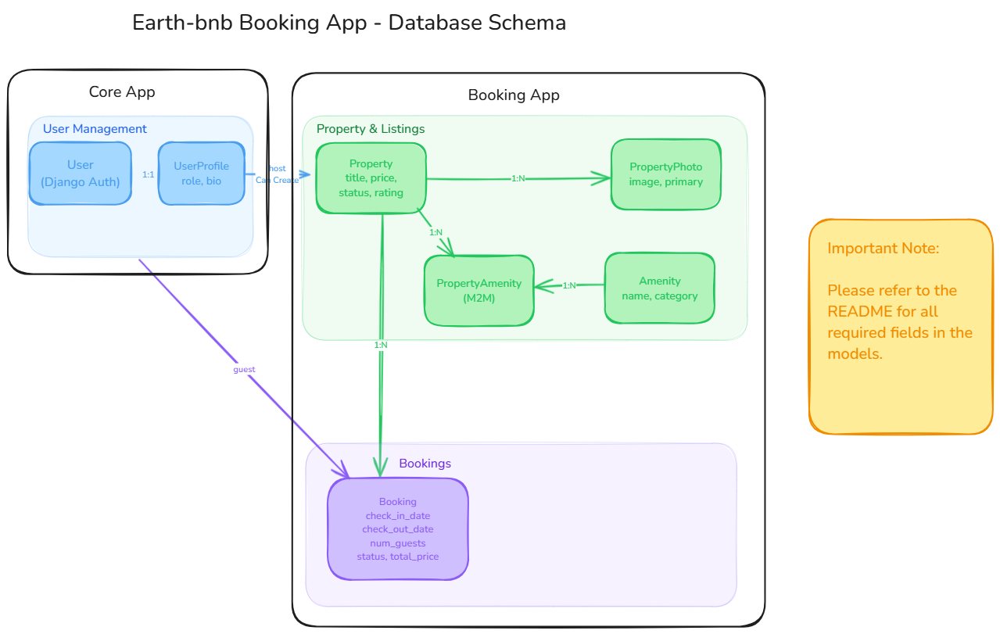
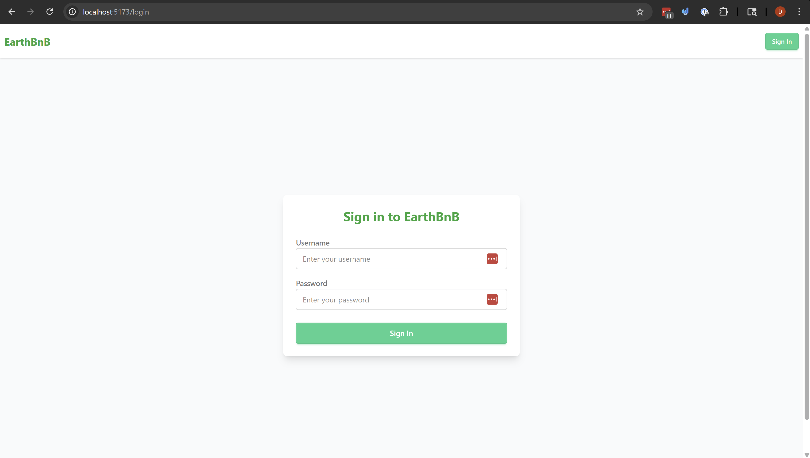
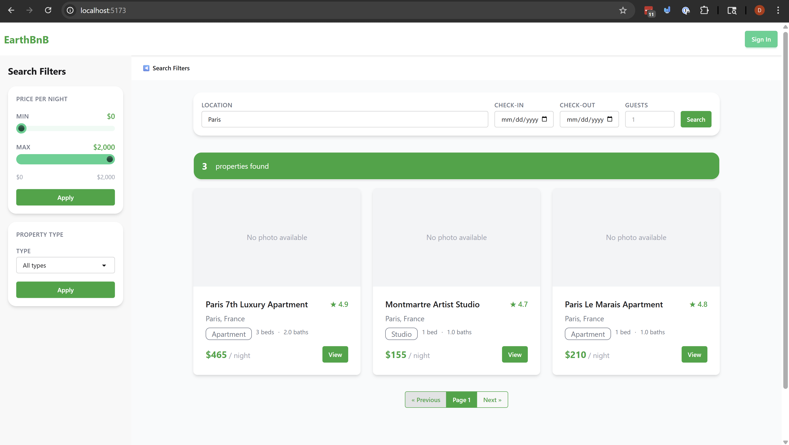
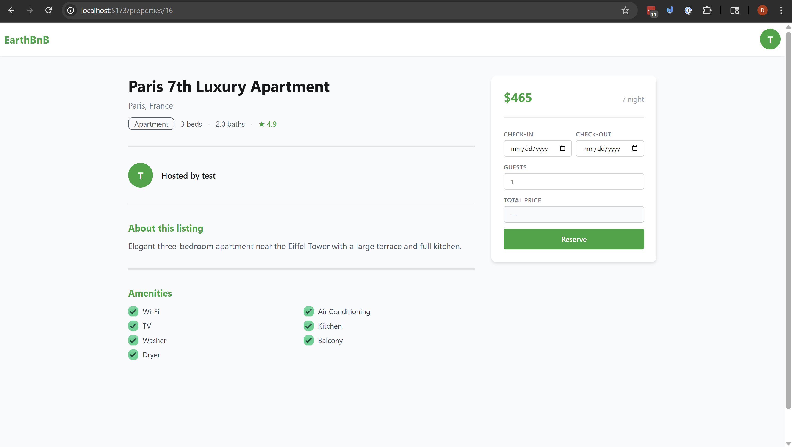
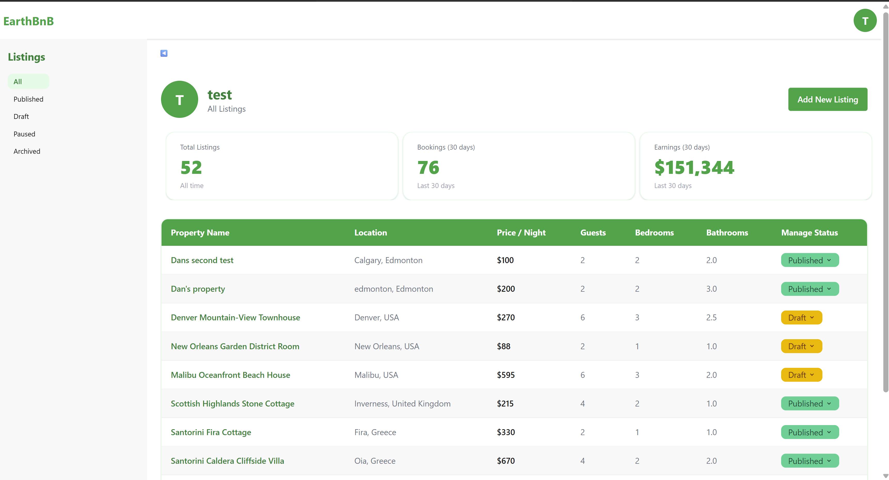
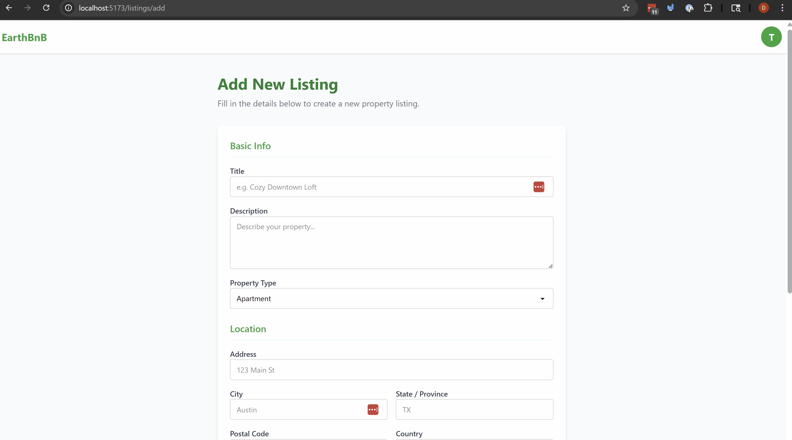
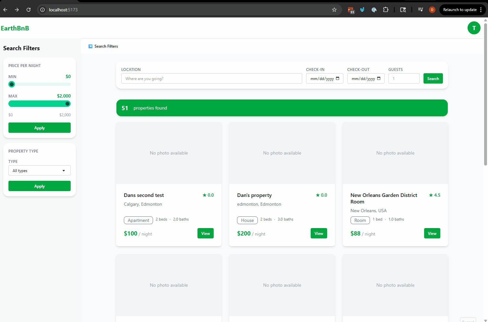
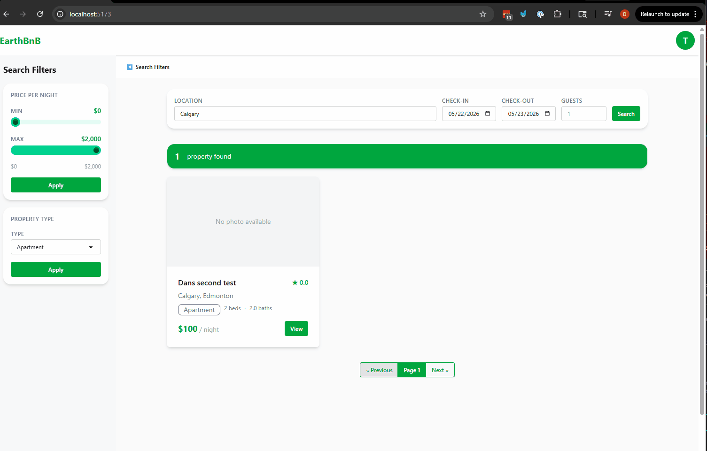

# SDEV 2401 - Assignment 4 Building EarthBnB implementing a Full-Stack Project as a Group

This assignment focuses on building a complete full-stack application called EarthBnB, a property rental platform similar to Airbnb. You will implement a Django REST Framework backend with JWT authentication, comprehensive property and booking management APIs, and a React frontend with advanced filtering, authentication, and host management features.

This is intended to be a group project that you learn how to work together to build a complex application like you would in a real-world software development environment. You will be expected to use version control with Git and GitHub, collaborate on code through pull requests, and manage your project using issues and a project board.

Quick Links:
- [Groups, Team Collaboration and Project Management](#groups-team-collaboration-and-project-management)
- [AI Usage](#ai-usage-permitted-but-must-be-documented)
- [Instructions](#instructions)
    - Link to all todos: [todo.md](todo.md)
- [Expected output](#expected-output)
- [Rubric](#rubric)
- [Feature Implementation Summary](#feature-implementation-summary)

## AI Usage Permitted but must be documented

*AI is allowed* for this assignment but you must document the use of your AI tools and prompts in the [prompts](prompts/) folder. Duplicate the [prompts_template_duplicate_for_team_member](prompts/prompts_template_duplicate_for_team_member.md) replace "prompts_template_duplicate_for_team_member" with your name, and fill it out with any tools you used and prompts you used to generate code. Failure to do so will lead to academic integrity violations.

## Groups, Team Collaboration and Project Management

### Team Size and Collaboration.

- You will work in groups of *2-4 members* to complete this project. Groups of 4 are recommended to allow for a good distribution of work and collaboration, but groups of 2 or 3 are also acceptable if necessary due to odd numbers or other circumstances.

### Project Management and Version Control.

#### Using Pull Requests for Collaboration

- **All changes to the codebase must be made through pull requests.**
This means that each team member should create a separate branch for their work and submit a pull request to merge their changes into the main branch. This allows for code review, discussion, and collaboration on changes before they are integrated into the main codebase.
- **All Pull Request must be reviewed by at least one other team member before being merged.**
This ensures that multiple team members are familiar with all parts of the codebase and can provide feedback on changes.

#### Project Management and accountability

- **Usage of issues is required to discuss and track tasks, features, and bugs.**
Each feature or task should have its own issue that can be assigned to team members and tracked through completion.
- **Usage of a github project board is required to manage the workflow and progress of the project.**
The project board should have columns for different stages of work (e.g., To Do, In Progress, Review, Done) and issues should be moved across the board as they progress.
- **You need to create a "Standup" issue that is updated at minimum weekly, with updates from each team member on what they have worked on, what they are planning to work on next, and any blockers they are facing.**
This helps ensure regular communication and accountability within the team.
- **You need to write your own documenation for how to setup and run the project within the DOCUMENTATION.md file in the root of your repository.**
This should include instructions for setting up the development environment, loading data, running tests, running the backend and frontend, and any other relevant information for someone who wants to run your application.

#### Personal Contribution and Grading

Lab 4 is a report that you will submit individually that describes your personal contribution to the project, the challenges you faced, and how you overcame them. This report will be used to assess your individual contribution to the project and will be a factor in your grade for this assignment.

## Instructions

A note on the instructions here these are described in Parts but are not supposed to be completed in this order. You should work on the features in an order that makes sense for your team and development process.

The only order that is required is:
1. Guest Search Feature (frontend and backend)
2. Host Property Management (frontend and backend)

Everything else can be done in the order that makes sense for your team.

[**IMPORTANT** link to all todos are here](todo.md)

### Part 1: Backend Setup, Configuration, and Authentication

#### 1.1 Project Initialization
1. Create a virtual environment and install required packages from the `requirements.txt` file.
2. Run the initial migrations to set up the database.
3. Ensure both apps are registered in the project settings file.

#### 1.2 Install and Configure Dependencies
1. Install `djangorestframework` for API development.
2. Install `djangorestframework-simplejwt` for JWT token authentication.
3. Install `django-cors-headers` to enable cross-origin requests from your React frontend.
4. Install `django-filter` for advanced filtering capabilities.
5. Configure CORS settings in `settings.py` to allow requests from your frontend application during development.
6. Update the REST_FRAMEWORK settings to use Simple JWT as the default authentication class.
7. Configure the SIMPLE_JWT settings to define token lifetimes and other JWT behavior.

Note: Refer to the class examples and for setup of this part.

#### 1.3 Create and Configure the Custom User Model
1. In `core/models.py`, create a custom user model that extends Django's `AbstractUser`.
2. Add a `role` field to the user model with choices for different user types (e.g., guest, host, admin).
3. Update the `settings.py` file to set `AUTH_USER_MODEL` to point to your custom user model.
4. Create and apply migrations for the custom user model.
5. Register the custom user model in `core/admin.py` so it can be managed through the Django admin interface.

#### 1.4 Create Authentication Endpoints
1. Create a `UserSerializer` for returning user information that includes id, username, email, and role.
2. In `core/views.py`, create a registration view that accepts POST requests with user data and creates new user accounts.
3. Create a "me" view that returns the authenticated user's profile information.
4. In `core/urls.py`, create URL patterns for the registration and "me" endpoints.
5. Include the `core` URLs in the main project `urls.py` with the path prefix `v1/auth/`.

Note: The registration piece is a [Challenge](#challenges) and is optional, you can create users through the createsuperuser command and then modify hosts through the django admin if you choose not to implement registration.

#### 1.5 Test Authentication Endpoints
1. Start the Django development server.
2. Use a tool like Postman or curl to test the registration endpoint by creating a new user with username, email, password, and role.
3. Test the login endpoint by obtaining JWT tokens (access and refresh tokens) using user credentials.
4. Test the token refresh endpoint to verify that you can refresh expired access tokens.
5. Test the "me" endpoint by making an authenticated request to verify that it returns the correct user information.

### Part 2: Property Management System with Advanced Filtering

#### 2.1 Create Property and Related Models
1. In `booking_app/models.py`, create a `Property` model with fields for:
   - name (CharField)
   - description (TextField)
   - property_type (CharField with choices)
   - address (CharField)
   - city (CharField)
   - country (CharField)
   - bedrooms (IntegerField)
   - bathrooms (IntegerField)
   - max_guests (IntegerField)
   - price_per_night (DecimalField)
   - status (CharField with choices: published, draft, paused, archived)
   - host (ForeignKey to the User model)
   - created_at (DateTimeField, auto_now_add=True)
   - updated_at (DateTimeField, auto_now=True)

2. Create an `Amenity` model with fields for:
   - name (CharField)
   - description (TextField, optional)

3. Create a `PropertyAmenity` model to implement a many-to-many relationship between Property and Amenity with:
   - property (ForeignKey to Property)
   - amenity (ForeignKey to Amenity)
Note: this can be through a many to many field on the property model or through a custom model like this, the choice is up to you.

4. Register all models in `booking_app/admin.py` for management through the Django admin interface.
5. Create and apply migrations for all new models.

Note: Property Photos are part of the [Challenge](#challenges) and are optional, you can use placeholder images for properties if you choose not to implement property photos.

#### 2.2 Create Property Serializers and ViewSet
1. In `booking_app/serializers.py`, create a `ReadOnlyPropertySerializer` that includes:
   - All property fields
   - Nested serialization of related amenities
   - Nested serialization of property photos
   - Host information (id, username, email)

2. Create a `CreateUpdatePropertySerializer` for write operations that includes:
   - All necessary fields for creating or updating a property
   - Validation to ensure required fields are present

3. In `booking_app/views.py`, create a `PropertyViewSet` that:
   - Uses `ReadOnlyPropertySerializer` for read operations (list, retrieve)
   - Uses `CreateUpdatePropertySerializer` for write operations (create, update, partial_update)
   - Sets appropriate permissions for different actions

4. Implement filtering for the PropertyViewSet using `django-filter` to filter by:
   - City (CharField filter)
   - Country (CharField filter)
   - Property type (ChoiceFilter)
   - Status (ChoiceFilter)
   - Minimum price (NumberFilter)
   - Maximum price (NumberFilter)
   - Number of bedrooms (NumberFilter)
   - Maximum guest capacity (NumberFilter)
   - Amenities (using AND logic - all selected amenities must be present)
   - Host ID (NumberFilter to show properties by a specific host)

5. Implement a search filter that allows users to search by:
   - Property title/name
   - Description
   - City
   - Country
   (Case-insensitive searches that return partial matches)

6. Implement an availability filter that excludes properties with overlapping pending or confirmed bookings for requested check-in and check-out dates.

Essentially if a property has a booking with a check-in and check-out date that overlaps with the requested check-in and check-out date, then that property should be excluded from the search results. See the [Expected Output](#expected-output) section for examples of how this should work.

7. Add pagination to the PropertyViewSet to display 10 results per page.

8. Create a custom permission class `IsHostUser` in `core/permissions.py` to restrict certain actions to property hosts.

#### 2.3 Create Custom Property ViewSet Actions
1. Create a `host_properties` action in the PropertyViewSet that:
   - Returns all properties owned by the authenticated user (host)
   - Supports pagination with 10 results per page
   - Supports filtering by property status
   - Requires authentication and the host permission
   - Responds at the URL path `/api/v1/properties/host_properties/`

2. Create a `host_stats` action in the PropertyViewSet that:
   - Returns statistics for the authenticated host including:
     - Total number of listings
     - Number of bookings in the last 30 days
     - Total earnings in the last 30 days
   - Requires authentication and the host permission
   - Responds at the URL path `/api/v1/properties/host_stats/`

#### 2.4 Configure URLs for Property Endpoints
1. In `booking_app/urls.py`, create URL patterns for the PropertyViewSet using a router:
   - `GET /api/v1/properties/` - list all properties with filters
   - `POST /api/v1/properties/` - create a new property
   - `GET /api/v1/properties/{id}/` - retrieve a specific property
   - `PATCH /api/v1/properties/{id}/` - partial update a property
   - `DELETE /api/v1/properties/{id}/` - delete a property
   - `GET /api/v1/properties/host_properties/` - list authenticated host's properties
   - `GET /api/v1/properties/host_stats/` - get host statistics

2. Include the booking app URLs in the main project `urls.py` with the path prefix `v1/api/`.

### Part 3: Booking Management System

#### 3.1 Create Booking Model and Validation
1. In `booking_app/models.py`, create a `Booking` model with fields for:
   - property (ForeignKey to Property)
   - guest (ForeignKey to the User model)
   - check_in_date (DateField)
   - check_out_date (DateField)
   - num_guests (IntegerField)
   - status (CharField with choices: pending, confirmed, cancelled, completed)
   - created_at (DateTimeField, auto_now_add=True)
   - updated_at (DateTimeField, auto_now=True)

2. Implement model methods or properties that:
   - Calculate the number of nights from check-in to check-out
   - Calculate the nightly rate from the property
   - Calculate the subtotal (nightly rate × number of nights)
   - Calculate the total price (including any applicable fees or taxes)

3. Register the Booking model in `booking_app/admin.py`.
4. Create and apply migrations for the Booking model.

#### 3.2 Create Booking Serializer with Validation
1. In `booking_app/serializers.py`, create a `BookingSerializer` that:
   - Includes fields for property, guest, check_in_date, check_out_date, num_guests, and status
   - Includes calculated fields for nightly_rate, num_nights, subtotal, and total_price
   - Validates that check-out date is after check-in date
   - Validates that the number of guests does not exceed the property's max_guests
   - Validates that there are no overlapping confirmed or pending bookings for the requested dates
   - Returns appropriate error messages for validation failures

#### 3.3 Create Booking ViewSet
1. In `booking_app/views.py`, create a `BookingViewSet` that:
   - Allows authenticated users to create bookings via POST
   - Allows authenticated users to retrieve a list of their own bookings via GET
   - Automatically scopes bookings to show only the authenticated user's bookings
   - Requires authentication for all actions
   - Uses the `BookingSerializer` for serialization

#### 3.4 Configure URLs for Booking Endpoints
1. In `booking_app/urls.py`, create URL patterns for the BookingViewSet:
   - `POST /api/v1/bookings/` - create a new booking
   - `GET /api/v1/bookings/` - list authenticated user's bookings

### Part 4: Comprehensive Testing Suite

#### 4.1 Create Tests for Property ViewSet
1. Create a test file `tests/test_property_viewset.py` that includes tests for:
   - Listing all properties without filters
   - Listing properties with each individual filter type (city, country, type, status, price range, bedrooms, max guests, amenities)
   - Listing properties with multiple filters combined
   - Retrieving a specific property
   - Creating a new property as an authenticated host
   - Updating a property as the owner
   - Partially updating a property
   - Deleting a property as the owner
   - Permission tests (non-hosts cannot create properties)

#### 4.2 Create Tests for Search Functionality
1. Create tests in `tests/test_property_search.py` that verify:
   - Searching for properties by title
   - Searching for properties by description
   - Searching for properties by city
   - Searching for properties by country
   - Case-insensitive search functionality
   - Search that returns multiple matching results
   - Search that returns no results
   - Combined search and filter queries

#### 4.3 Create Tests for Booking ViewSet
1. Create a test file `tests/test_booking_viewset.py` that includes tests for:
   - Creating a booking with valid data
   - Rejecting bookings with invalid check-in/check-out dates
   - Rejecting bookings when num_guests exceeds max_guests
   - Rejecting bookings that overlap with existing confirmed bookings
   - Listing bookings for the authenticated user
   - Unauthenticated users cannot create or list bookings
   - Proper error messages for validation failures

#### 4.4 Create Tests for Authentication
1. Create a test file `tests/test_auth.py` that includes tests for:
   - User registration with valid credentials
   - User registration with duplicate username or email (should fail)
   - User login with correct credentials
   - User login with incorrect credentials (should fail)
   - JWT token generation upon login
   - Token refresh functionality
   - Accessing the "me" endpoint with a valid token
   - Accessing the "me" endpoint without authentication (should fail)

#### 4.5 Create Tests for Host Actions
1. Create a test file `tests/test_host_viewset.py` that includes tests for:
   - Authenticated hosts can access their properties via host_properties action
   - Non-host users cannot access the host_properties action
   - Unauthenticated users cannot access the host_properties action
   - Authenticated hosts can access host_stats
   - host_stats returns correct values for total listings, recent bookings, and earnings
   - host_properties supports filtering by status
   - host_properties supports pagination

### Part 5: Frontend Setup, API Client, and Authentication

#### 5.1 Initialize React Project and Install Dependencies
1. Install React Router for navigation and routing.
2. Install TanStack Query (React Query) for server state management.
3. Install Daisy UI for UI components and styling.
4. Configure Vite with environment variables to store the backend API URL.

#### 5.2 Create API Client Layer
1. In `src/api/client.js`, create an `apiClient` instance that:
   - Includes a request interceptor that adds the JWT bearer token from localStorage to all requests
   - Includes a response interceptor that handles 401 errors by attempting to refresh the token
   - Implements deduplication logic to prevent multiple simultaneous token refresh attempts
   - Automatically logs out the user if token refresh fails
   - Provides a callback mechanism for external code to register auth state callbacks

2. Create `src/api/auth.js` with functions for:
   - `registerUser(username, email, password, role)` - registers a new user
   - `loginUser(username, password)` - authenticates a user and returns tokens
   - `refreshToken(refreshToken)` - refreshes an expired access token
   - `fetchMe()` - retrieves the authenticated user's profile information

3. Create `src/api/properties.js` with functions for:
   - `fetchProperties(filters)` - fetches properties with support for all filter parameters (city, country, type, status, price range, bedrooms, guests, amenities, host, search, availability)
   - `fetchPropertyDetails(id)` - fetches detailed information about a specific property
   - `createProperty(propertyData)` - creates a new property
   - `updateProperty(id, propertyData)` - updates an existing property via PATCH

4. Create `src/api/bookings.js` with functions for:
   - `createBooking(bookingData)` - creates a new booking

5. Create `src/api/hosts.js` with functions for:
   - `fetchHostDetails()` - fetches the authenticated host's profile
   - `fetchHostStats()` - fetches host statistics
   - `fetchHostProperties(page, status)` - fetches the host's properties with pagination and status filtering

#### 5.3 Create Context Providers
1. Create `src/contexts/AuthContext.jsx` that:
   - Stores authenticated user information (id, username, role)
   - Stores JWT tokens (access and refresh)
   - Provides login mutation that stores tokens and user info in localStorage
   - Provides logout mutation that clears localStorage and updates context
   - Provides token refresh functionality
   - Automatically initializes from localStorage on app load
   - Exposes user, tokens, login, logout, and refresh functions to consumers

2. Create `src/contexts/PropertySearchFiltersContext.jsx` that:
   - Stores search filters including:
     - Search query
     - Minimum and maximum price
     - Property type
     - Check-in date
     - Check-out date
     - Number of guests
     - Current page for pagination
   - Provides methods to update filters
   - Persists filters to localStorage

3. Create `src/contexts/NotificationContext.jsx` that:
   - Manages toast notifications with message, type (success/error/info), and visibility state
   - Provides a function to show notifications
   - Auto-dismisses notifications after 3.5 seconds
   - Renders notifications as a visual toast component

#### 5.4 Create Custom Hooks
1. Create `src/hooks/useAuth.js` that:
   - Provides access to AuthContext
   - Returns user, tokens, login, logout, and refresh functions

2. Create `src/hooks/usePropertySearchFilters.js` that:
   - Provides access to PropertySearchFiltersContext
   - Returns all filter values and update functions

3. Create `src/hooks/useNotification.js` that:
   - Provides access to NotificationContext
   - Returns a function to trigger notifications

4. Create `src/hooks/useProperties.js` that:
   - Uses TanStack Query to fetch properties
   - Accepts filter parameters from the search context
   - Handles loading and error states
   - Provides a mutation for creating properties with cache invalidation

5. Create `src/hooks/usePropertyDetails.js` that:
   - Uses TanStack Query to fetch a single property by ID
   - Handles loading and error states

6. Create `src/hooks/useCreateBooking.js` that:
   - Uses TanStack Query mutation to create bookings
   - Handles error parsing for DRF validation errors
   - Shows appropriate error messages via notifications
   - Updates cache on success

7. Create `src/hooks/useHostProperties.js` that:
   - Uses TanStack Query to fetch the authenticated host's properties
   - Reads page and status filters from the PropertySearchFiltersContext
   - Supports pagination with hasNext and hasPrevious indicators
   - Handles loading and error states

8. Create `src/hooks/useHostDetails.js` that:
   - Uses TanStack Query to fetch authenticated host profile via `/auth/me/`
   - Handles loading and error states

9. Create `src/hooks/useHostStats.js` that:
   - Uses TanStack Query to fetch host statistics
   - Returns total listings, recent bookings, and earnings

### Part 6: Frontend Layout and Navigation

#### 6.1 Create Layout Components
1. Create `src/components/layout/Navbar.jsx` that:
   - Displays the EarthBnB logo/branding
   - Shows a "Sign In" button when no user is authenticated
   - Shows the user's avatar with a dropdown menu when authenticated
   - Includes a logout option in the dropdown
   - Displays a "My Host Profile" link visible only to authenticated hosts
   - Is responsive and works on mobile devices

2. Create `src/components/layout/DrawerLayout.jsx` that:
   - Provides a collapsible sidebar drawer for filters and navigation
   - Displays the main content area
   - Is fully responsive and mobile-friendly
   - Allows the sidebar to be toggled on mobile devices

3. Create a root `src/layouts/MainLayout.jsx` that wraps pages with Navbar and optionally DrawerLayout.

#### 6.2 Create Authentication Components
1. Create `src/components/auth/ProtectedRoute.jsx` that:
   - Wraps protected routes and requires user authentication
   - Redirects unauthenticated users to the login page with a return URL
   - Supports an optional `requiredRole` prop to restrict access to specific user roles
   - Displays an "Unauthorized" message for users with insufficient permissions

#### 6.3 Create Form Components
1. Create `src/components/forms/SearchPropertiesForm.jsx` that:
   - Includes inputs for location, check-in date, check-out date, and number of guests
   - Integrates with PropertySearchFiltersContext to update search state
   - Triggers property search on form submission

2. Create `src/components/forms/filters/PropertyPriceFilter.jsx` that:
   - Displays a dual-handle range slider (0-10000, step 50)
   - Allows users to set minimum and maximum price filters
   - Updates PropertySearchFiltersContext on value change

3. Create `src/components/forms/filters/PropertyTypeFilter.jsx` that:
   - Displays a select dropdown with property type options
   - Integrates with PropertySearchFiltersContext
   - Updates the filter on selection change

4. Create `src/components/forms/BookingForm.jsx` that:
   - Pre-populates check-in, check-out, and guest count from search filters
   - Includes a property price display
   - Calculates and displays booking total price
   - Submits booking via useCreateBooking hook
   - Shows inline success/error messages
   - Triggers toast notifications on success/error

5. Create `src/components/forms/AddListingForm.jsx` that:
   - Includes all fields for creating a new property:
     - Title, description, property type
     - Address, city, state, postal code, country
     - Bedrooms, bathrooms, max guests
     - Price per night, status
   - Uses useProperties hook to submit the form
   - Shows a loading spinner on the submit button during submission
   - Displays inline error alerts for validation failures
   - Redirects to host profile on successful creation

### Part 7: Frontend Components - Properties

#### 7.1 Create Property Display Components
1. Create `src/components/property/PropertyCard.jsx` that:
   - Displays a property with:
     - Primary photo
     - Title
     - Location (city, country)
     - Price per night
     - Property type
     - Bedrooms and bathrooms count
     - Star rating (if available)
   - Includes a "View" button that links to the property details page
   - Is responsive and works on all screen sizes

2. Create `src/components/property/SearchResults.jsx` that:
   - Uses useProperties hook to fetch filtered properties
   - Displays a loading spinner while data is being fetched
   - Shows error messages if the fetch fails
   - Renders a list of PropertyCard components
   - Includes pagination controls below the results

3. Create `src/components/property/SearchResultsPagination.jsx` that:
   - Displays Previous and Next buttons for pagination
   - Updates the page number in PropertySearchFiltersContext
   - Disables the Previous button on the first page
   - Disables the Next button when there are no more results

### Part 8: Frontend Components - Host Management

#### 8.1 Create Host Dashboard Components
1. Create `src/components/host/HostStatsCard.jsx` that:
   - Displays a single statistic with:
     - Stat title
     - Stat value (formatted appropriately)
     - Description
   - Uses green color scheme for visual consistency

2. Create `src/components/host/HostStatsSection.jsx` that:
   - Calls useHostStats hook internally
   - Renders three HostStatsCard components for:
     - Total listings
     - Bookings in last 30 days
     - Earnings in last 30 days
   - Shows a loading spinner while data is being fetched
   - Displays error alerts if the fetch fails

3. Create `src/components/host/HostPropertyTable.jsx` that:
   - Displays a table of the host's properties with columns for:
     - Property name
     - Location
     - Price per night
     - Max guests
     - Bedrooms and bathrooms
     - Status (with ability to change)
   - Shows a loading spinner while data is being fetched
   - Displays error messages if the fetch fails
   - Shows an empty state row when no properties exist

4. Create `src/components/host/PropertyStatusDropdown.jsx` that:
   - Displays the current status as an inline badge
   - Opens a Daisy UI dropdown menu on click
   - Allows users to select a new status
   - Submits the status change via PATCH request
   - Shows a spinner while the mutation is in flight
   - Invalidates host properties cache on successful update

### Part 9: Frontend Pages and Routing

#### 9.1 Create Main Pages
1. Create `src/pages/HomePage.jsx` that:
   - Uses DrawerLayout with filters in the sidebar
   - Displays SearchPropertiesForm in the main content area
   - Renders SearchResults component to show filtered properties
   - Is fully responsive

2. Create `src/pages/LoginPage.jsx` that:
   - Displays a login form with username and password inputs
   - Uses useAuth hook to handle login
   - On successful login, redirects to the previous page or home
   - Displays error messages for login failures
   - Includes a link to the registration page

3. Create `src/pages/RegisterPage.jsx` that:
   - Displays a registration form with:
     - Username, email, password fields
     - Role selection dropdown
   - Calls registerUser from api/auth.js
   - Redirects to login page on successful registration
   - Displays validation error messages

4. Create `src/pages/PropertyDetailsPage.jsx` that:
   - Fetches property details via usePropertyDetails hook
   - Displays full property information:
     - Title, location, type
     - Bedrooms, bathrooms, max guests
     - Star rating
     - Host information
     - Full description
     - List of amenities
     - Photo gallery
   - Includes BookingForm component for making reservations
   - Shows loading and error states
   - Requires authentication

5. Create `src/pages/HostDetailsPage.jsx` that:
   - Uses DrawerLayout with a sidebar containing listing tabs
   - Sidebar tabs for filtering by status: All, Published, Draft, Paused, Archived
   - Displays host avatar and name
   - Includes an "Add New Listing" button that links to AddListingPage
   - Renders HostStatsSection component
   - Renders HostPropertyTable component with pagination
   - Updates page filter when navigating between pages
   - Resets page to 1 when changing status filter
   - Requires authentication and host role

6. Create `src/pages/AddListingPage.jsx` that:
   - Uses AddListingForm component
   - Shows success toast notifications on property creation
   - Shows error toast notifications on validation failures
   - Redirects to host profile on successful creation
   - Requires authentication and host role

#### 9.2 Configure Routing
1. In `src/App.jsx`, set up React Router with the following routes:
   - `/` - HomePage
   - `/login` - LoginPage
   - `/register` - RegisterPage
   - `/properties/:id` - PropertyDetailsPage (protected)
   - `/hosts/:id` - HostDetailsPage (protected, host role required)
   - `/listings/add` - AddListingPage (protected, host role required)

2. Wrap the entire application with required providers:
   - QueryClientProvider for TanStack Query
   - AuthProvider for authentication state
   - NotificationProvider for notifications
   - PropertySearchFiltersProvider for search filters

### Part 10: Documentation and Deployment Preparation

#### 10.1 Create Comprehensive Documentation
1. Create a `README.md` file in the project root that includes:
   - Project overview and description
   - Technology stack (Backend: Django, DRF, JWT; Frontend: React, Vite, TanStack Query)
   - Instructions for running the backend:
     - Creating and activating virtual environment
     - Installing dependencies
     - Running migrations
     - Creating a superuser
     - Starting the development server
   - Instructions for running the frontend:
     - Installing dependencies via npm
     - Setting environment variables (VITE_API_URL)
     - Starting the development server
   - API documentation showing:
     - Authentication endpoints
     - Property endpoints with filter parameters
     - Booking endpoints
   - Frontend setup instructions
   - Instructions for running the test suite

#### 10.2 Code Quality and Testing
1. Ensure all backend tests pass by running the test suite.
2. Generate a test coverage report to verify at least 80% code coverage.
3. Set up frontend tests using Vitest and React Testing Library.
4. Create tests for key frontend components and hooks.
5. Ensure the code follows PEP 8 style guidelines on the backend.
6. Use proper formatting and linting on both backend and frontend.

#### 10.3 Environment Variables and Configuration
1. Document all required environment variables for both frontend and backend.
2. Create sample `.env.example` files for both projects.
3. Ensure sensitive information is never committed to version control.
4. Verify that the backend can serve media files from the media directory during development.
5. Test the application with CORS enabled to allow frontend-backend communication.

## Expected Output

### Database Schema

The database schema should look like this:

### Backend Endpoints

For the data expected for the REST API endpoints please refer to the [Backend README](booking_project_backend/README.md) for the expected request and response formats for all API endpoints.

### Frontend Mockups

#### Login Page

#### Home Page with Search and Filters

#### Property Details Page

#### Host Dashboard Page

#### Add Listing Page

### Full Application Flow

#### Searching, Filtering and Booking

#### Host Property Management

### Part 1-3: Backend API Testing (Shown in Postman or similar tool)

The backend should provide fully functional REST API endpoints for:
- User registration and authentication with JWT tokens
- Complete CRUD operations for properties with advanced filtering
- Property listing by hosts with pagination and status filtering
- Host statistics including earnings and booking data
- Booking creation and retrieval with validation

### Part 5-9: Frontend Application

The frontend should display:
- A functional home page with search and filter capabilities
- Property listings with pagination
- Detailed property views with booking forms
- User authentication with login and registration
- Host dashboard with property management
- Host statistics and earnings tracking
- Responsive design that works on mobile and desktop devices

## Challenges

These challenges will need you to implement the design and functionality on your own without specific instructions. One is worth 5 points and you can choose to implement one or more of them for extra credit.

### Implement a Map View for Property Listings
- Integrate a mapping library (e.g., Leaflet or Google Maps) to display property locations on a map.
- Show property markers on the map based on their address or geolocation data.

### Implement a Favorites/Wishlist Feature
- Allow users to save properties to a favorites list.
- Create API endpoints to manage favorites and a frontend UI to view and manage the wishlist.

### Implement a "My Bookings" Page for Guests
- Create a page where guests can view their upcoming and past bookings.
- Include details about each booking and the associated property.
- Allow guests to cancel upcoming bookings from this page.

### Implement a "Edit Property" Page for Hosts
- Create a page where hosts can edit their existing property listings.
- Pre-populate the form with the current property data and allow updates to all fields.
- Ensure that changes are reflected in the host dashboard and property listings.

### Implement Two or more of the following additional filters for property search:
- Filter by specific amenities (e.g., show properties that have a pool or free Wi-Fi)
- Filter by host response time (e.g., show properties from hosts who respond within an hour)
- Filter by guest rating (e.g., show properties with high guest ratings)

### Fully Deploy the Application on a cloud platform and make it publicly accessible and functional.
- Deploy the backend API to a platform like Heroku, AWS, or DigitalOcean, Railway, Render, etc.
- Deploy the frontend application to a platform like Vercel, Netlify, or the same platform as the backend if it supports full-stack deployments.
- Ensure that the deployed application is fully functional, with all features working correctly in the production environment.

### Implement the Registration flow.
- Create a registration page that allows new users to sign up with a username, email, password, and role (guest or host).
- Implement the backend API endpoint to handle user registration and create new user accounts.
- Ensure that the registration process includes validation and error handling for duplicate usernames/emails and invalid input

## Implement property photos functionality.
- Allow hosts to upload multiple photos for their properties.
- Store photos in the media directory and serve them correctly in both development and production environments.
- Display property photos in the frontend application, including a gallery view on the property details page.

### Implement your own custom feature and enhancement that adds significant value to the application. This could be a unique feature not mentioned in the challenges above, an improvement to existing functionality, or a creative addition to the user experience. Be sure to document your custom feature clearly in the README and provide instructions for how to use it.
- Marks will be given to the discretion of the instructor based on the complexity and value added by the custom feature, as well as the quality of its implementation and documentation.

## Rubric

### Standups

There are 4 standup classes during the semester. Your instructor will tell you when they are scheduled.

Standups are graded individually. Any deductions apply only to your own project grade, not to your teammates' grades.

- **Missing a standup:** -5% off your project grade for each standup you miss.
- **No meaningful progress:** -2.5% off your project grade for each standup where you can't show meaningful progress since the last one. Your instructor decides what counts as meaningful progress.

### 45 points - Feature Implementation and Functionality

Points are prorated based on the number of members in the group.

Points will not be evenly distributed across all team members if the contribution is not balanced. Each team member will receive a score based on their individual contribution to the project, which may differ from the overall project score. This will be evaluated based on:
- a report that you will submit for lab 4
- your commits
- your pull requests
- your code reviews
- your contributions to issues and discussion
- your standup updates
- and any other relevant evidence of contribution to the project (or lack there of) that I have found and, and your team members have reported.

| Level                | Feedback Description                                                                                                       |
| -------------------- | -------------------------------------------------------------------------------------------------------------------------- |
| Perfect              | All features completed and working perfectly with no bugs or issues.                                                       |
| Excellent            | All features completed and working with minimal bugs that do not impact core functionality.                                |
| Good                 | Most features implemented with good functionality; minor bugs present but the application is largely usable.               |
| Satisfactory         | Some features implemented with reasonable functionality; some bugs present that affect parts of the application.           |
| Incomplete           | Few features implemented with minimal functionality; many bugs present that significantly impact usability.                |
| Poor                 | Few features implemented with a significant number of bugs; core functionality is largely broken.                          |
| Insufficient         | Not enough features implemented to evaluate functionality.                                                                 |

### 5 points - One Challenge Implemented (5 bonus points per challenge implemented)

| Level                | Feedback Description                                                                                                       |
| -------------------- | -------------------------------------------------------------------------------------------------------------------------- |
| Complete             | Challenge fully implemented and working correctly with no issues.                                                          |
| Mostly Complete      | Challenge mostly implemented and functional with only minor issues.                                                        |
| Partial              | Challenge partially implemented with some functionality working but key parts missing or broken.                           |
| Attempted            | Challenge attempted with minimal functionality; significant portions are missing or non-functional.                        |
| Not Implemented      | Challenge not implemented.                                                                                                 |

### 20 points - Testing, Code Quality, and Documentation

| Level                | Feedback Description                                                                                                       |
| -------------------- | -------------------------------------------------------------------------------------------------------------------------- |
| Excellent            | 85%+ test coverage with comprehensive, well-written tests; clear and complete documentation for setup, API, and usage.     |
| Good                 | 70–85% test coverage with adequate tests covering main features; documentation is present and mostly complete.             |
| Satisfactory         | 50–70% test coverage with some tests; documentation exists but is incomplete or lacks important details.                   |
| Poor                 | Below 50% test coverage with minimal or low-quality tests; documentation is sparse or difficult to follow.                 |
| Missing              | No tests or documentation provided.                                                                                        |

### 30 points - Collaboration, Teamwork/Project Management, and Personal Contribution

| Level                | Feedback Description                                                                                                                                                                                                               |
| -------------------- | ---------------------------------------------------------------------------------------------------------------------------------------------------------------------------------------------------------------------------------- |
| Excellent            | Excellent collaboration and teamwork with clear communication throughout; effective project management with consistent, incremental commits from all members; significant and balanced personal contributions from every team member. |
| Good                 | Good collaboration with regular communication; solid project management with frequent commits; good personal contributions from most team members with minor imbalances.                                                            |
| Satisfactory         | Satisfactory collaboration and communication; adequate project management with some incremental commits; moderate personal contributions though some members contributed more than others.                                          |
| Mixed                | Mixed collaboration with inconsistent communication; limited project management evidenced by infrequent or uneven commits; uneven personal contributions with some members contributing significantly less.                         |
| Poor                 | Poor collaboration and teamwork with little evidence of communication; ineffective project management with very few commits concentrated in one member; minimal personal contributions from most team members.                      |
| Insufficient         | No meaningful evidence of collaboration, project management, or individual contribution.                                                                                                                                           |

## Academic Integrity Note

You must demonstrate incremental development of your solution. This means that you must begin work on your solution as soon as possible and commit often to the assignment repository. Each commit must demonstrate functional improvements to the solution. Just like in a professional environment, leaving a task untouched until right before the deadline is not acceptable — start early and make consistent progress. Failure to show incremental work during the assignment period will result in loss of marks of up to 20%.

## Feature Implementation Summary

The EarthBnB application should be a complete, full-stack property rental platform with the following features:

**Backend Features:**
- User authentication and registration with JWT tokens
- Property management with advanced filtering and search
- Booking system with date validation and guest count validation
- Host dashboard with property management and statistics
- Comprehensive test coverage for all major features

**Frontend Features:**
- User authentication and registration
- Property search and discovery with filters
- Property details page with booking form
- Host dashboard for managing listings
- Host statistics and earnings tracking
- Responsive design for mobile and desktop
- Toast notifications for user feedback
- Protected routes requiring authentication
